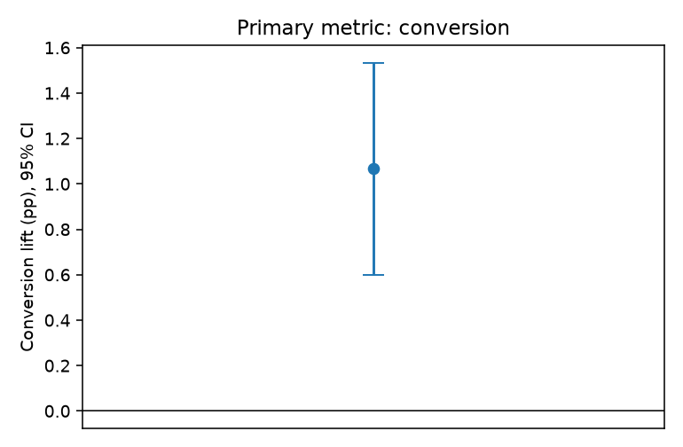
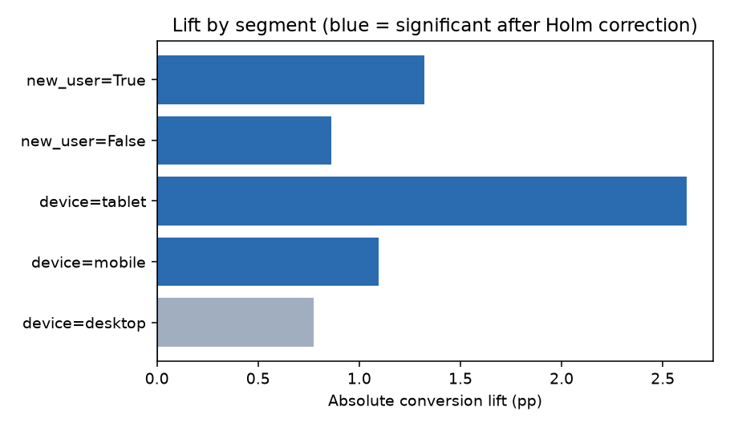

# A/B test analysis: paywall-offer experiment

**Synthetic data, real method.** Users, assignment and outcomes are simulated with a fixed seed in
`analysis.py`; no employer data is used. The point is the analysis workflow.

## Experiment
Does a new paywall offer (variant) raise conversion to paid subscription versus the current offer (control)?
Primary metric: conversion rate. Secondary: sessions per user in the test window. Guardrail: sample-ratio check.

## 1. Design (power and sample size)
Baseline conversion 6.0%; minimum detectable effect +0.6pp (10% relative);
alpha 0.05, power 80%. Required users per arm: **25,727**. The test ran with 42,000 users
(20,937 control / 21,063 variant).

## 2. Sample-ratio mismatch check
Expected a 50/50 split. Chi-square p = 0.539. No sign of an assignment problem.

## 3. Primary result
Control 5.87% vs variant 6.94%: absolute lift **+1.07pp** (+18.2% relative),
95% CI [+0.60, +1.53]pp, p = 0.0000. Decision: **ship the variant**.

## 4. Variance reduction with CUPED (sessions per user)
Using pre-experiment engagement as a covariate cut the standard error of the sessions estimate
(variance reduction 72%). p-value moved from 0.000 (raw) to 0.000 (CUPED).
Smaller variance means the same test can detect smaller effects or run shorter.

## 5. Segments (with correction)
Segment cuts inflate false positives, so p-values are Holm-adjusted. Segments significant after
correction: device=mobile, device=tablet, new_user=False, new_user=True. Segment results are for generating hypotheses, not for
shipping decisions on their own.

## Caveats I would raise with a real experiment
- Pre-register the metric and stopping rule; avoid peeking at p-values.
- Check novelty effects and run for at least one full weekly cycle.
- Look at guardrails (refunds, churn at 30/60 days), not just conversion.

## Run it
`pip install pandas numpy scipy statsmodels matplotlib` then `python analysis.py`.
